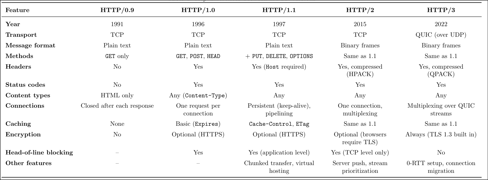
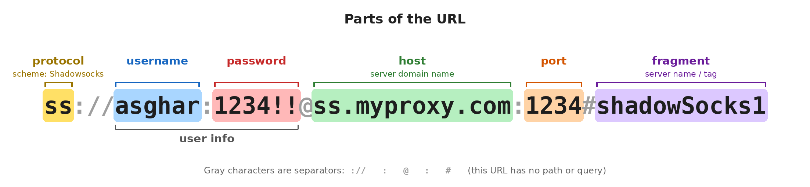

# 📝 Web Programming HW2

> **Author:** Kaveh Ahmadi / lkavehamdl  
> **Date:** Oct 26 2026  

- [Question 1](#question-1)
- [Question 2](#question-2)
- [Question 3](#question-3)
- [Question 4](#question-4)
- [Question 5](#question-5)
- [Question 6](#question-6)
- [Disclaimer](#%EF%B8%8F-disclaimer)

---

## Question 1

**Answer:**Differences of HTTP versions is in the table below:

And for "Why does HTTP/3 use UDP?":

TCP treats all data as one single stream. If one packet is lost, everything behind it has to wait until it is sent again. This is called head-of-line blocking, and in HTTP/2 it slows down every file on the page, even unrelated ones. TCP is also very hard to change, because it is built into operating systems and network devices.

UDP is simple and almost every network lets it through, so QUIC was built on top of it. QUIC adds reliability, ordering, congestion control and encryption by itself, but for each stream separately. This means a lost packet only stops its own stream.

## Question 2

**Answer:**

A: In stateless communication, the server doesn’t remember anything about earlier requests. Each request is independent and must carry all the information the server needs. In stateful communication, the server keeps information about the client between requests, so it knows what happened before. Stateless systems are simpler and easier to scale, while stateful systems can continue a conversation but use more server resources.

B: HTTP is a stateless protocol. The server treats every request as new, so on its own it can’t remember things like who is logged in or what’s in your shopping cart. To fix this, HTTP uses a few methods like cookies or tokens.
## Question 3
**Answer:**

**A:** 

In HTTP, only the client can start a conversation. The server can’t send anything on its own.This becomes a problem when the server has new data at an unexpected time, like a new chat message, an alert, or an event that another system should know about.

**B:** 

**Short polling:** The client sends a request to the server at fixed intervals and asks “is there anything new?”. It’s very simple and works everywhere, but most responses are empty. This wastes bandwidth and server resources, and the data still arrives with some delay.

**Long polling:** The client sends a request, but the server doesn’t answer right away. It keeps the request open until new data is ready, then responds, and the client immediately sends a new request. This gives almost real-time updates with fewer empty responses, but every message still needs a new request, and holding many open connections is heavy for the server.

**Server-Sent Events (SSE):** The client opens one normal HTTP connection, and the server keeps it open and sends events through it whenever it wants. It’s built into browsers and reconnects automatically. Its limit is that it’s one-way only, so it fits notifications and live feeds better than chat.

**WebSocket:** The connection starts as HTTP and then upgrades to the WebSocket protocol with a 101 response. After that, client and server both can send messages at any time over the same connection, with very little overhead. This makes it the most common choice for chat, online games and live dashboards, but it needs more work on the server to manage connections.

**Webhooks:** Instead of the client asking again and again, the roles are reversed. The receiver gives the service a URL, and when an event happens, the service itself sends an HTTP request (usually POST) to that URL. This is common between servers, for example a payment service telling a shop that a payment was successful. The receiver must have a public endpoint and should check that the requests are real.

**Web Push:** Browsers and phones keep a connection to a push service. The server sends the message to this push service, and it delivers the notification to the user’s device, even when the website isn’t open. It’s great for alerts but not for frequent or large data.

**WebTransport:** A newer option based on HTTP/3 and QUIC. Like WebSocket, it allows two-way communication, but it supports multiple streams and can send data without strict ordering, so one lost packet doesn’t block everything. It’s still new, so browser and server support is more limited.

## Question 4

**Answer:**

## Question 5
**Answer:**

1: 500 Internal Server Error or 503 Service Unvailable should be used based on database is crashing when data arives or the entire database is down

2: 401 Unauthorized or 404 Not found should be used based on we are accessing a privilaged page with that user or we just want to login and the user doesn't exist, although 404 is used for pages that doesn't exist.

3: 301 Permanently Moved since the move is permanent to a new location

4: 429 Too Many Requests, this status code is used when rate limiter tirggers and limits requests from useers

5: 200 OK

6: 403 Forbidden, we are living with this one 

## Question 6
**Answer:**

**1:**

**Caching Proxy**: the university server sits on the users’ side and gets packages for them. The first time a package is downloaded, it’s saved, so the next users get it fast from the local server without going to the main servers. This saves internet bandwidth and makes downloads quicker.

**2:**

**Load Balancer:** this proxy sits on the server side. It looks at where each request comes from and sends it to the nearest or most suitable server, for example users from Asia to the Asia server. CDNs work in a similar way, which gives users lower delay and spreads the load between servers.

**3:**

**Authentication Proxy:** the old service is hard to change, so a proxy is put in front of it. Every request first goes to the proxy, which checks the user’s login. Only valid requests are passed on to the old service, so it gets authentication without changing its code.

## ⚠️ Disclaimer

I used AI to create the template and image used in Q1 and Q3
.